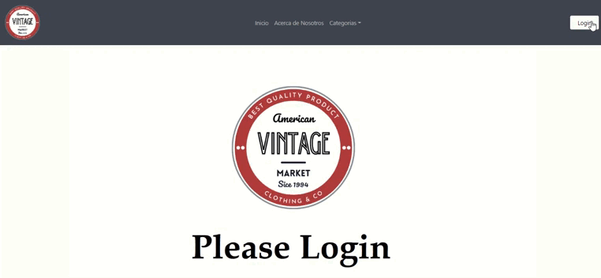
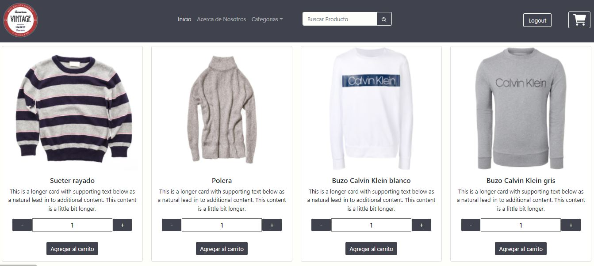
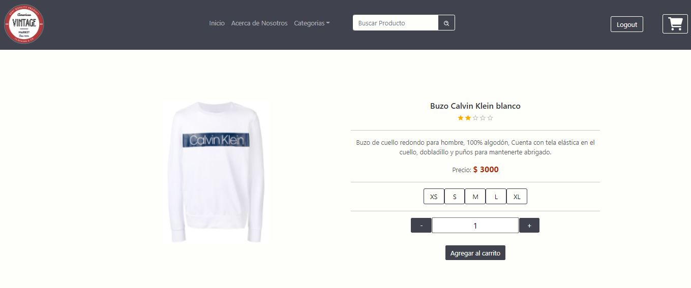

  
    
        
  

  

    E-commerce Varela
  

# Feria Americana Online

E-commerce desarrollado en React, que simboliza una feria americana online, para comercializar ropa usada.

## Demo

>
---

## Funcionalidad del proyecto

Esta web muestra los productos a la venta. Los usuarios pueden agregar o remover productos de su carrito, donde se especifica la cantidad de cada item, para luego comprarlos.

----------
## Imágenes de la web
----------

*Index*
>
----------

*Detalle de Producto*
>
----------

---

<i class="icon-cog"></i>**Dependencias del proyecto:**
>  
> - **Mui:** https://mui.com/
> - **React Bootstrap:** https://react-bootstrap.github.io/  <i class="icon-upload"></i>

**<i class="icon-cog"> Navegabilidad / Componentes**
> - [X] Responsive / estilos aplicados de forma estética.
> - [X] Manejo de imágenes.
> - [X] camelCase para eventos.
> - [X] PascalCase para componentes.
> - [X] Routes y Links para navegaciones.
> - [X] Navbar con carrito implementado.
> - [X] Promises y Hooks.

----------
## Scripts

El proyecto usa Vite.

| Comando | Qué hace |
| --- | --- |
| `npm run dev` | Levanta el servidor de desarrollo |
| `npm run build` | Compila el sitio en `build/` |
| `npm run preview` | Sirve localmente lo compilado |
| `npm run lint` | Corre ESLint |
| `npm test` | Corre las pruebas con Vitest |
| `npm run deploy` | Publica `build/` en GitHub Pages |

El sitio se publica bajo `/ecommerce-vintage/`, configurado en `base` dentro de `vite.config.js`.

## Datos y sesión

El proyecto no usa backend. Antes dependía de Firebase (Firestore para el catálogo y las órdenes, Firebase Auth para el login), pero ese proyecto quedó fuera de servicio y la demo dejó de funcionar. Hoy todo corre en el navegador:

- **Catálogo:** `src/data/items.json`, con las imágenes en `public/items/`. Lo lee `src/store/catalog.js`, que mantiene la forma asíncrona que tenía la consulta a Firestore.
- **Órdenes:** se guardan en `localStorage` y el checkout muestra el código generado.
- **Sesión:** `src/store/auth.js` simula el registro y el login contra `localStorage`.

> ⚠️ **El login es una simulación, no un sistema de autenticación.** Corre entero del lado del cliente y los usuarios viven en `localStorage`, donde cualquiera puede leerlos o modificarlos desde la consola del navegador. Está ahí para que la demo sea navegable; no lo reutilices en un proyecto real.

Para cambiar el catálogo, editá `src/data/items.json`. Cada producto necesita `id`, `titulo`, `precio`, `stock`, `category` (`invierno`, `verano`, `otonio` o `primavera`), `cartTexto` e `imagen`.
